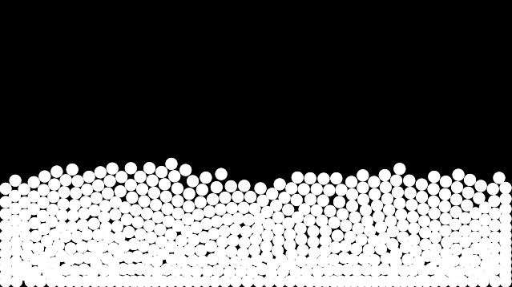

# Particles

500 particles are scattered across the top of the window, fall under gravity, collide and pile up
at the bottom. The whole simulation runs in compute passes on the GPU, and the fragment shader
draws the result. Press **R** to respawn the particles. Once a second the particle buffer is read
back and the average position and velocity are logged.

## What it shows

| Binding | Type | Used for |
|---|---|---|
| `group(0) binding(0)` | uniform buffer | simulation parameters: resolution, gravity, time step, radius, restitution, random seed |
| `group(1) binding(0)` | GPU buffer | particle positions and velocities, read back with `ReadbackMode::OnRequest` |
| `group(1) binding(1)` | GPU buffer | per-particle collision corrections, scratch space between passes |

Compute passes:
- `init` runs once as an init pass, and again when R calls `ComputePasses::rerun("init")`.
- `collide` then `integrate` run 4 times per frame as substeps.
- All three are sized with `Workgroups::over::<Particles>()`, one thread per particle.

## Files

| | App (CPU) | Shader (GPU) |
|---|---|---|
| WGSL | [`wgsl/app.rs`](wgsl/app.rs) | [`wgsl/shader.wgsl`](wgsl/shader.wgsl) |
| Rust (rust-gpu) | [`rust/app.rs`](rust/app.rs) | [`rust/shader.rs`](rust/shader.rs) |

The two versions run the same simulation and look the same.

## Running it

These files are for reference and aren't built by this crate. To run them:

- **WGSL:** in a project that depends on `bevy-shader-plugin`, copy `wgsl/app.rs` to
  `src/main.rs` and `wgsl/shader.wgsl` to `assets/shaders/particles.wgsl`, then `cargo run`.
- **Rust:** clone [bevy-shader-plugin-rust-template](https://github.com/EliDeCo/bevy-shader-plugin-rust-template),
  copy `rust/app.rs` over its `src/main.rs` and `rust/shader.rs` over its `shader/src/lib.rs`,
  then `cargo run`.
