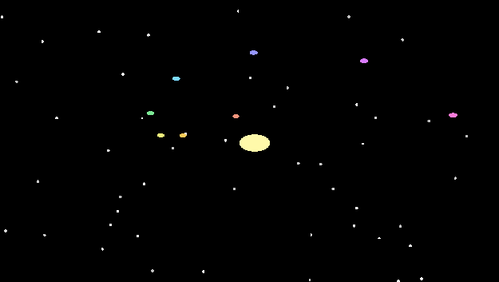

# Solar system



Eight planets orbit a star over a background star field. The CPU moves the planets every frame,
and a planet changes color each time it completes an orbit. A compute pass averages the planet
positions on the GPU, and the result is read back and logged every frame.

## What it shows

| Binding | Type | Used for |
|---|---|---|
| `group(0) binding(0)` | uniform buffer | window resolution |
| `group(1) binding(0)` | storage buffer, read-only | planet positions, re-uploaded every frame |
| `group(1) binding(1)` | storage buffer, `read_write` | average position, written by the compute pass and read back with `ReadbackMode::EveryFrame` |
| `group(2) binding(0)` | array buffer, read-only | planet colors, one element updated per completed orbit |

It also runs a single-thread compute pass with `Workgroups::exact`.

## Files

| | App (CPU) | Shader (GPU) |
|---|---|---|
| WGSL | [`wgsl/app.rs`](wgsl/app.rs) | [`wgsl/shader.wgsl`](wgsl/shader.wgsl) |
| Rust (rust-gpu) | [`rust/app.rs`](rust/app.rs) | [`rust/shader.rs`](rust/shader.rs) |

The two versions run the same simulation and look the same.

## Running it

These files are for reference and aren't built by this crate. They need Bevy's default
features (windowing and time) on top of what the plugin enables:

```toml
[dependencies]
bevy = "0.19"
bevy-shader-plugin = "0.2"                                     # WGSL
# bevy-shader-plugin = { version = "0.2", features = ["spirv"] } # Rust
```

- **WGSL:** in a project with the dependencies above, copy `wgsl/app.rs` to
  `src/main.rs` and `wgsl/shader.wgsl` to `assets/shaders/solar_system.wgsl`, then `cargo run`.
- **Rust:** clone [bevy-shader-plugin-rust-template](https://github.com/EliDeCo/bevy-shader-plugin-rust-template),
  copy `rust/app.rs` over its `src/main.rs` and `rust/shader.rs` over its `shader/src/lib.rs`,
  then `cargo run`.
